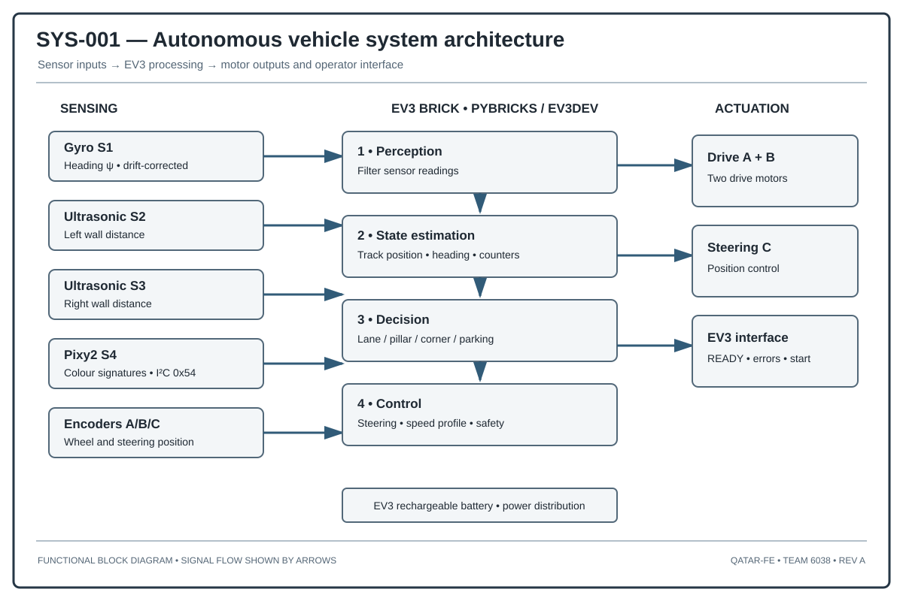
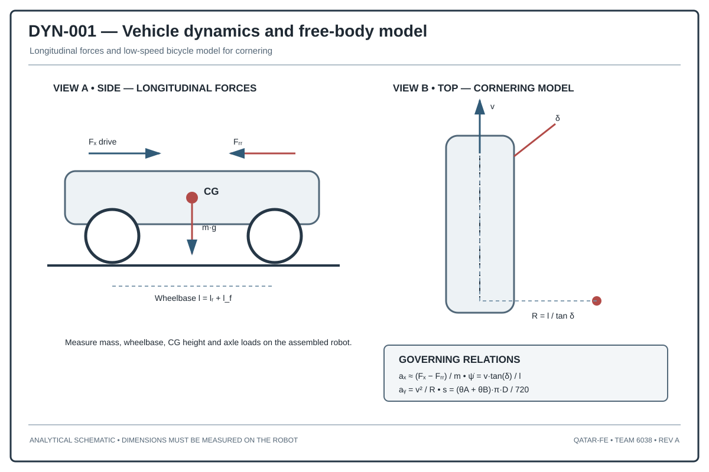
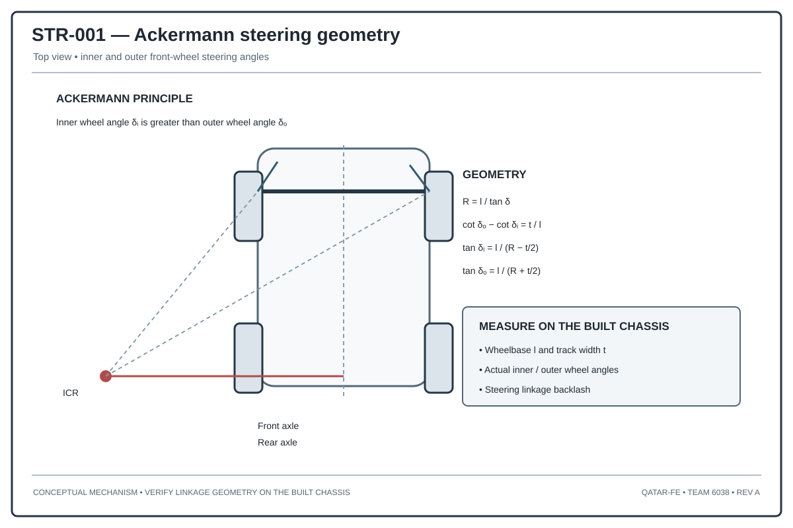
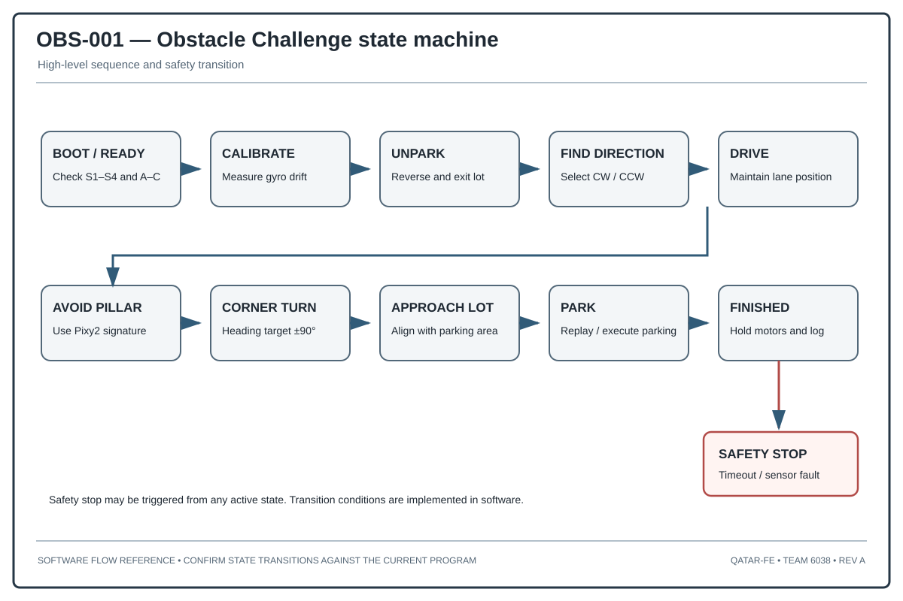
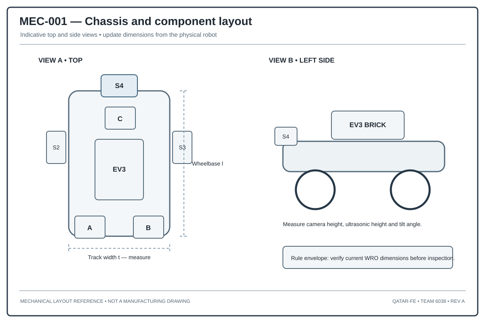
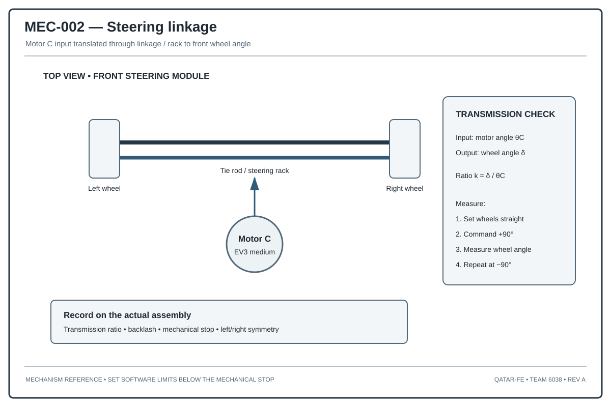
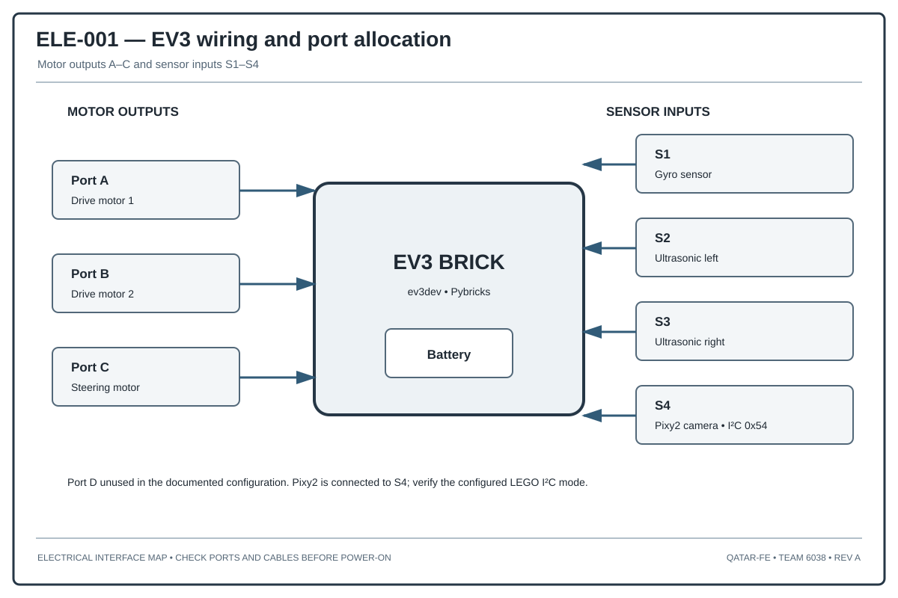
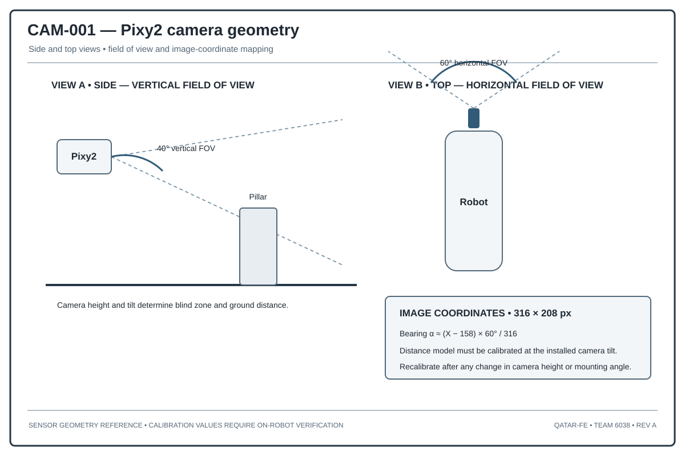

# Qatar-FE — Engineering Drawing Set

**WRO Future Engineers · Team 6038 · Revision A**

We made these drawings to help explain our robot's system layout, vehicle dynamics, steering, mission logic, chassis, electrical connections, and camera geometry. They are useful for design discussions and reviews, but they are not manufacturing drawings.

## Drawing list

| Drawing | What it shows | Main use |
|---|---|---|
| [SYS-001 — Autonomous vehicle system architecture](SYS-001_autonomous_vehicle_architecture.svg) | How sensors, controller, and motors connect | System overview |
| [DYN-001 — Vehicle dynamics](DYN-001_vehicle_dynamics.svg) | Longitudinal forces and cornering model | Dynamics study |
| [STR-001 — Ackermann steering geometry](STR-001_ackermann_steering.svg) | Inner and outer wheel angles and turning centre | Steering study |
| [OBS-001 — Obstacle Challenge state machine](OBS-001_obstacle_state_machine.svg) | Mission states and safety stop | Software design |
| [MEC-001 — Chassis layout](MEC-001_chassis_layout.svg) | Example top and side component positions | Mechanical layout |
| [MEC-002 — Steering linkage](MEC-002_steering_linkage.svg) | Motor C, rack, and tie-rod arrangement | Steering mechanism |
| [ELE-001 — EV3 wiring](ELE-001_ev3_wiring.svg) | Motor and sensor port allocation | Electrical setup |
| [CAM-001 — Pixy2 camera geometry](CAM-001_pixy2_camera_geometry.svg) | Camera field of view and image coordinates | Vision model |

## Drawing previews

### SYS-001 — System architecture

### DYN-001 — Vehicle dynamics

### STR-001 — Ackermann steering

### OBS-001 — Obstacle Challenge state machine

### MEC-001 — Chassis layout

### MEC-002 — Steering linkage

### ELE-001 — EV3 wiring

### CAM-001 — Pixy2 camera geometry

## How we keep drawings updated

When we change a drawing or the engineering details behind it, we record:

- Why we made the change.
- Which part of the robot is affected.
- Which source version we used.
- Any parameter changes.
- Related test evidence.
- How to return to the previous version if needed.

We update the revision in the drawing title block and in this list. If a change affects dimensions, wiring, sensor positions, calibration, or software interfaces, we also list the related drawings and source files. We do not label calculated or example values as measured test results.

### Revision history

| Revision | Date | Drawing or subsystem | Why it changed | Source version | Parameter changes | Test evidence | Rollback |
|---|---|---|---|---|---|---|---|
| A | 2026-11-11 | Initial drawing set | First engineering reference diagrams | Repository source snapshot | No physical dimensions claimed; check on robot | SVG files added to GitHub; physical checks still needed | Revert the drawing-set commit or restore the previous SVG version |

## Checks before using a drawing

- Check dimensions marked as measured against the assembled robot.
- Check the Pixy2 mounting height, tilt, and image geometry before using camera calibration values.
- Measure the steering ratio, backlash, and mechanical stops before setting final software limits.
- Check motor and sensor ports against the real wiring before each competition setup.
- Update the drawing revision and list when the hardware or software interfaces change.

**Status:** These are engineering reference drawings. Check dimensions, calibration values, and hardware details against the current robot before using them for fabrication, inspection, or performance claims.