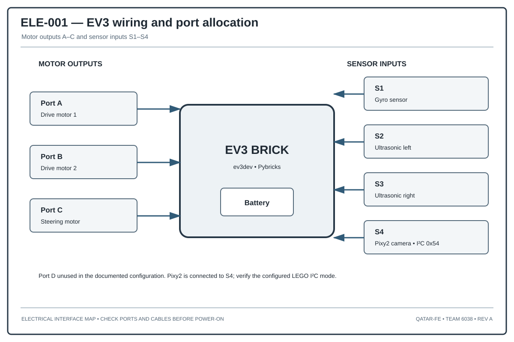

# Electrical Architecture and Integration

## 1. What this page explains

We use this page to describe the electrical connections shown in our software device map and to list the checks we need when assembling the robot. We have not added voltage, current, or connector ratings that are not confirmed by the component documentation.

## 2. Main electrical parts

| Part | Connection | What it does |
|---|---|---|
| EV3 controller | Motor and sensor ports | Runs the control program |
| Drive motor A | EV3 motor port A | Drives the vehicle |
| Drive motor B | EV3 motor port B | Drives the vehicle |
| Steering motor C | EV3 motor port C | Turns the front wheels |
| No device | EV3 motor port D | Not used by either challenge program |
| Gyro S1 | EV3 sensor port S1 | Gives heading feedback |
| Ultrasonic S2 | EV3 sensor port S2 | Measures the left-side distance |
| Ultrasonic S3 | EV3 sensor port S3 | Measures the right-side distance |
| Pixy2 camera with integrated illumination | I²C on EV3 sensor port S4 | Detects colour signatures in the Obstacle Challenge |

## 3. Power checks

The EV3 supply must stay within the manufacturer's operating limits when the drive and steering motors are working. When we carry out a power check, the record should include:

- Battery type and manufacturer.
- Nominal voltage and measured voltage.
- Connector and cable ratings.
- Peak current under a representative load.
- Any controller reset or brownout.
- Battery temperature after repeated runs.

The illumination is built into the Pixy2 camera assembly connected to S4. It is not a separate lamp connected to motor port D.

## 4. Keeping the signals reliable

- Route sensor cables away from moving steering and drive parts.
- Avoid sharp bends and repeated movement near the connectors.
- Secure the Pixy2 cable so the I²C connection does not move during a run.
- Check the I²C address and output mode before using the camera program.
- Make sure the sensors are initialized before the robot starts moving.

## 5. Faults and what we should do

| Possible fault | How we may notice it | Response |
|---|---|---|
| Gyro drift | Drift check at startup | Calibrate again or do not start |
| Invalid ultrasonic echo | Distance reading is outside the plausible range | Reject the reading and use only a defined fallback |
| Pixy2 I²C problem | Repeated communication errors | Stop or enter the defined safe state |
| Motor stall | Encoder does not show expected movement before timeout | Stop the drive and report the fault |
| Low battery | Voltage check | Stop below a threshold confirmed by testing |
| Loose sensor cable | Missing or unreasonable readings | Stop autonomous operation |