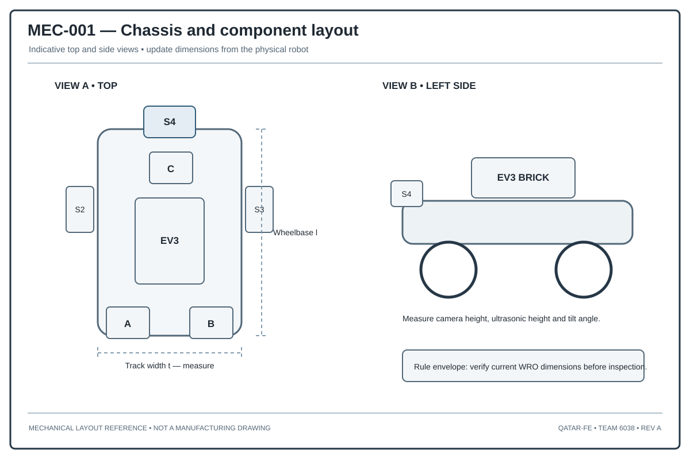
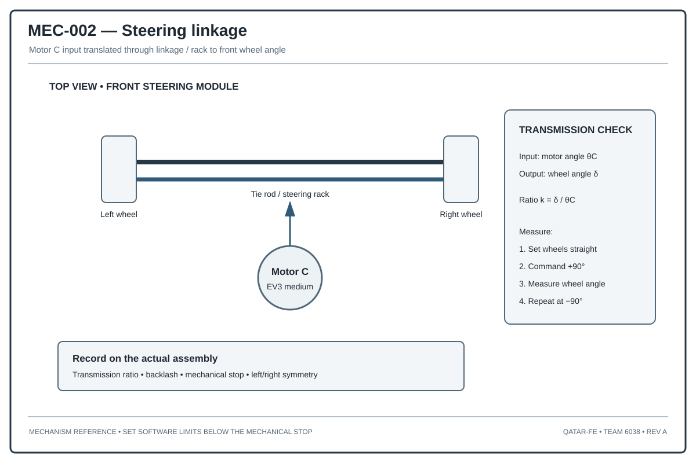

# Chassis and Component Layout

## 1. What the chassis needs to do

Our chassis needs to hold the drive system, steering, sensors, and EV3 controller in place. It should stay stiff enough to keep the wheels and sensors aligned, while still leaving room to reach the battery and other parts when we need to work on the robot.

The main things we consider are:
- Keeping the wheels aligned while the robot is moving.
- Limiting twisting and bending of the frame.
- Protecting wires and sensor connectors.
- Keeping the centre of gravity low.
- Keeping the steering geometry consistent.
- Making battery replacement and maintenance practical.
- Leaving enough room for the wheels, steering links, and cables to move.

## 2. A possible two-level layout

For the reference design, we consider a two-level arrangement.

**Lower mechanical level**
- Drive motors and wheel connections.
- Steering motor and linkage.
- Battery mounted as low as possible.
- Structural cross-members.
- Lower protective frame.

**Upper electronics level**
- EV3 controller.
- Sensor cables and connections.
- Camera mount for the obstacle configuration.
- Cable guides and strain relief.

This arrangement keeps most mechanical loads in the lower structure and helps us route cables away from the steering parts.

## 3. Where the forces go

Drive torque passes from the motor mounts into the chassis and then through the wheels to the floor. Steering forces travel from the front wheels through the steering arms and linkage to the steering motor support. If the robot hits something, the impact should be carried by the main frame, not by a sensor bracket or a printed electronics mount.

## 4. Chassis stiffness

For a simple beam, bending depends on the applied force, the span, the material stiffness, and the cross-section. When comparing frame designs, we should look at:
- Length of unsupported sections.
- Cross-section shape.
- Material stiffness.
- How stiff the joints are.
- Direction of the load.
- Distance between fasteners.

A stiffer frame can help keep the sensors aligned, but adding material everywhere also adds mass. It is better to reinforce the joints that carry the largest loads.

## 5. Space needed by the steering

We need to check the full movement of the steering arm, tie rod, wheels, and cable loop at both steering limits. The clearance should allow for print tolerances, joint play, frame movement, wheel runout, and cable movement.

No cable should pass through the path of a moving steering part.

## 6. Maintenance

We should use fasteners that are easy to reach, connectors that cannot be mixed up, labelled ports, and an assembly order we can repeat. We should also be able to remove important parts without taking the whole chassis apart.

## 7. Chassis check list

- [ ] Use one chassis reference line or datum for wheel alignment.
- [ ] Check that the drive motor mounts resist motor torque.
- [ ] Check that the steering motor mount can handle repeated loads.
- [ ] Move the steering through its full range and look for contact.
- [ ] Secure the battery so it cannot move during a run.
- [ ] Make sure the camera can see the required area.
- [ ] Align the ultrasonic sensors with the intended corridor directions.
- [ ] Add strain relief to cables.
- [ ] Inspect printed parts for cracks and layer separation.
- [ ] Keep fasteners accessible for inspection.