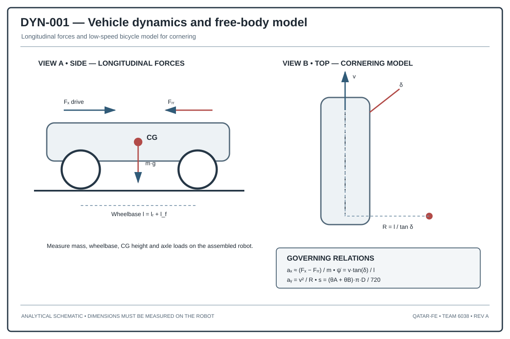

# Conceptual Study — Mass Distribution and Vehicle Dynamics

> **Study classification:** Conceptual engineering analysis. This document explores a theoretical vehicle architecture and does not assert that the described configuration has been manufactured, measured, or validated on the team's current robot.

## 1. Objectives

Mass distribution affects tire normal forces, traction, braking response, steering authority, cornering stability, vibration transmission, and the repeatability of sensor measurements. The purpose of this study is to establish a quantitative method for evaluating these effects and to define a design process for a compact autonomous vehicle.

The study is organized around five questions:

1. Where should the mass be located?
2. How does mass location change static wheel loads?
3. How does centre-of-gravity height affect load transfer?
4. How should the steering geometry interact with tire forces?
5. How can the theoretical model be verified experimentally?

## 2. Coordinate system and reference frame

Define a right-handed vehicle coordinate system:

- (x): forward, along the longitudinal centreline.
- (y): left, across the vehicle.
- (z): upward, normal to the ground plane.

Use the midpoint of the rear axle at ground level as the reference origin. The front axle is at (x=L), the rear axle at (x=0), and the lateral centreline is (y=0).

The reference geometry is represented by:
- (L): wheelbase.
- (T_f): front track width.
- (T_r): rear track width.
- (h_{CG}): centre-of-gravity height.
- (x_{CG}, y_{CG}, z_{CG}): centre-of-gravity coordinates.

No numerical geometry is assumed in this conceptual model unless an explicit design case is introduced.

## 3. Component mass model

Represent the vehicle as a collection of rigid components. For each component (i), record:

| Variable | Description |
|---|---|
| (m_i) | Component mass |
| (x_i,y_i,z_i) | Component centre coordinates |
| (I_{xx,i},I_{yy,i},I_{zz,i}) | Principal moments of inertia |
| (R_i) | Component envelope and clearance volume |
| (S_i) | Structural mounting interface |

The component register should include the chassis, drive motors, steering actuator, wheels, battery, controller, sensors, camera, wiring, printed adapters, fasteners, and protective structures.

### 3.1 Centre of gravity

For discrete component masses:

\[
M=sum_{i=1}^{n}m_i
\]

\[
x_{CG}=\frac{\sum_{i=1}^{n}m_i x_i}{M},\quad
y_{CG}=\frac{\sum_{i=1}^{n}m_i y_i}{M},\quad
z_{CG}=\frac{\sum_{i=1}^{n}m_i z_i}{M}
\]

The centre of gravity is therefore a mass-weighted position, not the geometric centre of the chassis.

### 3.2 Design implications

- A low battery location generally reduces centre-of-gravity height.
- Heavy components placed near the longitudinal centre reduce polar moment of inertia compared with the same components placed at the extreme ends.
- A lateral mass offset creates unequal static left/right wheel loads.
- A high-mounted camera or sensor assembly can increase roll sensitivity and structural vibration.
- Cable loops and movable components should be included when their mass is not negligible.

## 4. Static axle load distribution

For a vehicle on level ground with total weight (W=Mg), wheelbase (L), and longitudinal centre-of-gravity coordinate (x_{CG}):

\[
F_{z,front}=W\frac{x_{CG}}{L}
\]

\[
F_{z,rear}=W\left(1-\frac{x_{CG}}{L}\right)
\]

These equations assume static equilibrium, a rigid support plane, and no external longitudinal force.

A forward centre of gravity increases front axle load and reduces rear axle load. A rearward centre of gravity does the opposite. The correct balance depends on which axle provides propulsion and steering, tire characteristics, and the desired dynamic response.

## 5. Static left/right load distribution

For equal front and rear track (T), a simplified lateral equilibrium gives:

\[
F_{z,left}=W\left(\frac{1}{2}+\frac{y_{CG}}{T}\right)
\]

\[
F_{z,right}=W\left(\frac{1}{2}-\frac{y_{CG}}{T}\right)
\]

This simplified expression assumes a symmetric support geometry and a centred longitudinal distribution. For unequal tracks, four separate wheel reactions should be solved using force and moment equilibrium.

## 6. Four-wheel reaction model

Let the four tire contact points be at:
- Front-left: ((L,+T_f/2))
- Front-right: ((L,-T_f/2))
- Rear-left: ((0,+T_r/2))
- Rear-right: ((0,-T_r/2))

The vertical reactions (N_{FL},N_{FR},N_{RL},N_{RR}) must satisfy:

\[
N_{FL}+N_{FR}+N_{RL}+N_{RR}=W
\]

\[
\sum M_y=0,\qquad \sum M_x=0
\]

A unique four-contact solution requires additional assumptions about chassis rigidity, suspension compliance, or measured support deflection. For a rigid four-wheel chassis on an imperfect surface, the load distribution can be statically indeterminate.

## 7. Longitudinal load transfer

Under longitudinal acceleration (a_x), a simplified quasi-static load-transfer magnitude is:

\[
Delta F_x=\frac{M a_x h_{CG}}{L}
\]

During acceleration, normal load transfers toward the rear. During braking, it transfers toward the front.

The expression assumes a rigid body, level ground, negligible aerodynamic forces, and quasi-static pitch equilibrium. It is not a complete transient model.

## 8. Lateral load transfer and rollover margin

For lateral acceleration (a_y), a simplified total lateral load-transfer magnitude is:

\[
Delta F_y=\frac{M a_y h_{CG}}{T}
\]

Increasing track width reduces the load-transfer magnitude for the same mass, acceleration, and centre-of-gravity height. Reducing centre-of-gravity height has the same qualitative effect.

For an ideal rigid vehicle with symmetric track, a geometric static tip threshold is:

\[
a_{y,tip}\approx g\frac{T}{2h_{CG}}
\]

This is a theoretical threshold, not a safe operating limit. Tire grip, transient motion, structural flexibility, floor friction, and wheel lift dynamics can cause loss of control before this idealized condition.

## 9. Yaw inertia and manoeuvrability

The yaw moment of inertia about the vertical axis is:

\[
I_z=\sum_i\left(I_{z,i}+m_i[(x_i-x_{CG})^2+(y_i-y_{CG})^2]\right)
\]

Mass placed far from the centre of gravity increases yaw inertia. A compact central arrangement can improve rotational response, but component placement must also respect cooling, wiring, sensor field of view, and mechanical access.

## 10. Steering geometry and Ackermann condition

For a low-speed vehicle following a circular path, ideal Ackermann geometry requires the inner wheel to steer more sharply than the outer wheel.

\[
\cot(\delta_o)-\cot(\delta_i)=\frac{T}{L}
\]

where (delta_i) and (delta_o) are the inner and outer wheel angles.

The relation assumes pure rolling and a common instantaneous centre of rotation. Practical linkages approximate this condition within packaging and compliance constraints.

A complete steering study should include:
- steering pivot coordinates;
- tie-rod attachment points;
- steering arm lengths;
- actuator travel;
- mechanical stops;
- backlash and elastic deflection;
- wheel-angle measurements across the full steering range.

## 11. Traction and drive-force limits

A simplified tire friction bound is:

\[
|F_x|\leq \mu N
\]

where (mu) is the effective tire-floor friction coefficient and (N) is the wheel normal load.

For driven wheels, the maximum theoretical tractive force is limited by both motor torque and available tire friction:

\[
F_{drive}\leq \min\left(\frac{\tau_{wheel}}{r},\mu N_{driven}\right)
\]

This equation highlights why motor torque alone does not determine acceleration. If the driven axle is lightly loaded, additional motor torque can cause wheel slip rather than useful acceleration.

## 12. Sensor stability and vibration

A sensor's measured motion includes both vehicle motion and mounting vibration. A high centre of gravity, flexible chassis, loose sensor bracket, and long unsupported camera mount can increase image jitter and gyro disturbance.

Design controls include:
- mounting the gyro close to the rigid chassis reference;
- minimizing sensor bracket cantilever length;
- adding mechanical support without introducing excessive compliance;
- routing cables to avoid pulling on sensors;
- isolating high-frequency motor vibration only when the isolation does not compromise sensor alignment.

## 13. Battery and packaging strategy

The battery is often one of the heaviest movable components. A conceptual packaging strategy should evaluate:
- low vertical placement;
- central longitudinal placement;
- minimal lateral offset;
- secure retention under acceleration and cornering;
- access for replacement;
- protection from impact and cable strain.

The reference model treats mass placement as a vehicle-dynamics variable; the illustrative centre-of-gravity assumptions are not represented as measured mass properties.

## 14. Measurement and validation protocol

### 14.1 Mass inventory
Weigh each removable component separately using a calibrated scale. Record the measurement resolution and repeat each reading.

### 14.2 Component coordinates
Measure each component centre relative to the defined vehicle origin. For irregular components, estimate the centre of mass using a CAD mass-properties model or a suspension/balance method.

### 14.3 Four-wheel loads
Place each wheel on an independent scale at equal height. Record all four reactions simultaneously. Repeat after moving the battery or other heavy components.

### 14.4 Centre-of-gravity height
Use a controlled tilt-table method or a validated suspension method. Secure the vehicle and prevent it from sliding or falling. Do not infer CG height from photographs.

### 14.5 Dynamic tests
Perform low-speed acceleration, braking, and constant-radius turning tests. Record speed, heading, wheel slip, and any wheel unloading. Increase test severity gradually.

## 15. Engineering decision matrix

| Design choice | Potential benefit | Trade-off |
|---|---|---|
| Lower battery | Lower CG and reduced load transfer | Reduced ground clearance or service access |
| Central battery | Lower yaw inertia | Packaging conflicts |
| Wider track | Higher geometric roll threshold | Larger vehicle envelope |
| Longer wheelbase | Reduced pitch sensitivity for a given CG height | Larger turning footprint |
| Stiffer steering linkage | Better angle repeatability | Higher load on joints and actuator |
| Shorter sensor mounts | Reduced vibration leverage | Possible field-of-view constraints |

## 16. Conclusion

Mass distribution is a first-order design variable for a compact autonomous vehicle. A robust engineering decision requires a component mass register, coordinate-based centre-of-gravity calculation, static wheel-load measurements, and dynamic validation. The equations in this document provide a theoretical framework; they do not constitute measured properties or validated performance of a physical robot.

## 17. Required data to turn this study into a numerical design report

- Total vehicle mass and component masses
- Wheelbase and front/rear track measurements
- Component centre coordinates
- Tire radius and friction estimate
- Motor torque-speed data and gear ratio
- Steering pivot and tie-rod coordinates
- Measured acceleration and turning radius
- Four-wheel static load measurements
- Sensor mounting coordinates and vibration observations
