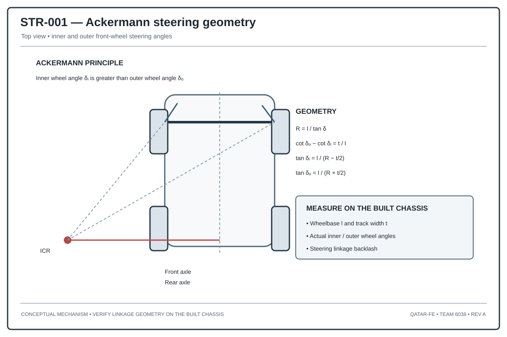

# Steering Geometry and Linkage Design

## 1. Design objective

We use steering geometry to relate the steering motor's rotation to the angle of the wheels. This affects the turning radius, tyre scrub, cornering path, motor load, and how consistently the robot turns.

## 2. Ideal low-speed geometry

For wheelbase (L), track (T), and turn radius measured to the rear-axle midpoint (R):

\[
\tan(\delta_i)=\frac{L}{R-T/2},\quad
\tan(\delta_o)=\frac{L}{R+T/2}
\]

The inner wheel angle \(\delta_i\) is greater than the outer wheel angle \(\delta_o\).

Equivalent Ackermann relation:

\[
\cot(\delta_o)-\cot(\delta_i)=\frac{T}{L}
\]

## 3. Linkage design variables

- Steering pivot coordinates
- Steering arm length and orientation
- Tie-rod length
- Actuator crank radius
- Neutral steering angle
- Left and right mechanical stops
- Joint clearance and backlash
- Structural compliance under tire load

## 4. Actuator-to-wheel mapping

Our control program needs to map the steering motor encoder angle \(\theta_m\) to road-wheel angle \(\delta_w\). For a nonlinear linkage, a lookup table or fitted polynomial can represent the actuator relationship more accurately than a constant ratio.

We can check this mapping as follows:
1. Place the vehicle on a level surface.
2. Measure road-wheel angle at multiple encoder positions on both sides.
3. Repeat while approaching each point from both directions to estimate backlash.
4. Fit a monotonic mapping and inspect residual error.
5. Set mechanical limits below the point of binding or excessive joint load.

## 5. Failure modes

| Failure mode | Effect | Design control |
|---|---|---|
| Linkage binding | High motor load or stalled steering | Check full-travel clearances |
| Excessive backlash | Inconsistent wheel angle | Reduce joint clearance |
| Unequal left/right travel | Asymmetric turning | Calibrate both directions |
| Flexible steering arms | Angle error under load | Increase stiffness or reduce lever arm |
| Loose printed joint | Sudden geometry change | Retention features and inspection |

## 6. Drawing definition

For our steering assembly drawing, we should show the top view, pivot positions, tie-rod length, steering-arm dimensions, actuator travel, left/right wheel angles, and mechanical stops.
