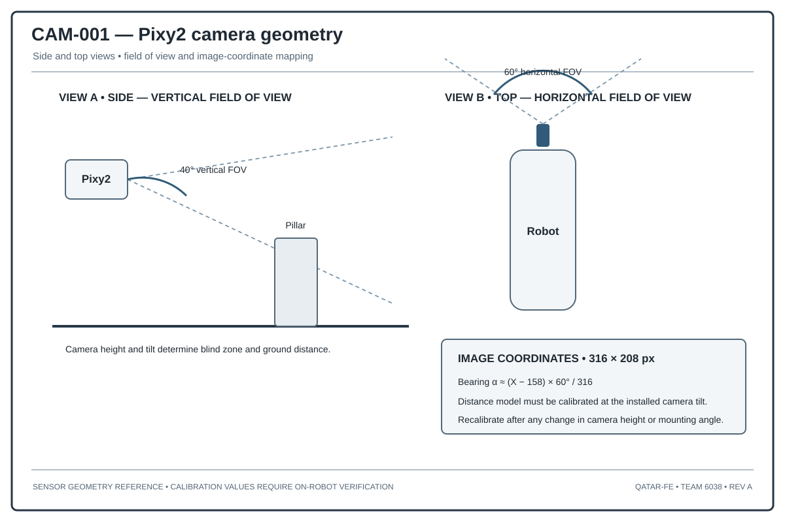

# Pixy2 Vision Calibration and Geometric Reconstruction

## 1. Purpose

The Obstacle Challenge program uses Pixy2 colour signatures to identify red and green pillars. The camera and its integrated illumination form one assembly connected through EV3 sensor port S4 using I²C. The camera does not directly measure range; range and lateral position are estimated from image geometry.

## 2. Coordinate conventions

Define image coordinates:
- (u): horizontal pixel coordinate, increasing to the right;
- (v): vertical pixel coordinate, increasing downward;
- ((u_c,v_c)): calibrated image centre;
- (f_x,f_y): effective focal lengths in pixel units.

Define vehicle coordinates:
- (X): forward;
- (Y): left;
- (Z): upward.

## 3. Pinhole bearing model

For horizontal pixel coordinate (u):

\[
\alpha=\tan^{-1}\left(\frac{u-u_c}{f_x}\right)
\]

The effective focal length may be estimated from the horizontal field of view (phi_h) and image width (N_u):

\[
f_x=\frac{N_u/2}{\tan(\phi_h/2)}
\]

## 4. Ground-plane range model

If a visible pillar base is assumed to lie on a known ground plane, a calibrated camera height and downward pitch can be used to estimate ground range. For a camera with height (h_c), downward pitch (\theta), and vertical ray angle (\beta), a simplified planar model is:

\[
d=\frac{h_c}{\tan(\theta+\beta)}
\]

This model is sensitive to the exact pixel coordinate representing the pillar base, camera pitch, and mounting height. It is not interchangeable with a top-edge image-height model. The symbols \(\theta\) and \(\beta\) denote angles in the camera's vertical plane.

## 5. Empirical calibration alternative

The supplied program uses an empirical vertical-image model:

\[
d=\frac{K}{v-v_0}
\]

with configured constants (K) and (v_0). These constants define the empirical model used by the current program; they are configuration values, not universal camera parameters.

Calibration model context: the empirical constants (K) and (v_0) are configured model parameters. The repository's numerical table is calculated from those constants and rounded image coordinates; it is not a measured camera-calibration dataset.

## 6. Colour classification

Signature IDs are camera configuration labels, not universal colour codes. The documented project mapping assigns signature 1 to red and signature 2 to green. Lighting, exposure, ambient illumination, and background are environmental variables in the perception model.

## 7. Confidence and temporal filtering

The implemented detection pipeline applies signature filtering, minimum block dimensions, aspect-ratio limits, image-region constraints, and multi-frame temporal confirmation. Median or trimmed-mean filtering is a general method for reducing single-frame jitter; detections from different pillar identities are treated as separate objects.

## 8. Calibration report

### 8.1 Calibration model

The image-to-range conversion uses the empirical model configured in the Obstacle Challenge program:

\[
d=\frac{K}{v-v_0}
\]

where:
- (d) is the estimated camera-to-pillar distance in millimetres;
- (v) is the selected vertical image feature in pixels;
- (K=20100\;\text{px}\cdot\text{mm});
- (v_0=63\;\text{px}).

The corresponding inverse relation used to construct the reference coordinate column is:

\[
v=v_0+\frac{K}{d}
\]

### 8.2 Calibration calculation table

| Known range (mm) | Image feature (px) | Estimated range (mm) | Error (mm) |
|---:|---:|---:|---:|
| 150 | 197 | 150.00 | 0.00 |
| 200 | 164 | 199.01 | -0.99 |
| 250 | 143 | 251.25 | +1.25 |
| 300 | 130 | 300.00 | 0.00 |
| 350 | 120 | 352.63 | +2.63 |
| 400 | 113 | 402.00 | +2.00 |
| 450 | 108 | 446.67 | -3.33 |
| 500 | 103 | 502.50 | +2.50 |
| 600 | 96 | 609.09 | +9.09 |
| 700 | 92 | 693.10 | -6.90 |
| 800 | 88 | 804.00 | +4.00 |
| 900 | 85 | 913.64 | +13.64 |

**Data status:** The image coordinates in this table are calculated reference coordinates, not camera measurements. They are generated by rounding \(v=v_0+K/d\) to the nearest pixel. The listed estimated ranges and errors are then calculated from the rounded coordinates.  

**Error convention:** \(e=d_{estimated}-d_{known}\). A positive value indicates overestimation; a negative value indicates underestimation.

### 8.3 Calculation example

For a known range of 600 mm, the corresponding rounded image feature is 96 px:

\[
d=\frac{20100}{96-63}=609.09\;\text{mm}
\]

\[
e=609.09-600=+9.09\;\text{mm}
\]

### 8.4 Summary statistics

| Metric | Result |
|---|---:|
| Number of reference points | 12 |
| Mean absolute error (MAE) | 3.86 mm |
| Root mean square error (RMSE) | 5.50 mm |
| Maximum absolute error | 13.64 mm |
| Maximum error location | 900 mm reference range |

### 8.5 Engineering interpretation

The error increases toward the far end of the range because the distance model becomes increasingly sensitive to pixel quantization as (v) approaches (v_0). This behaviour is expected from the inverse relationship between image position and estimated range.

The model is most sensitive when the detected feature is close to the offset coordinate. The model's useful operating range is bounded by the accepted error as (v) approaches (v_0), rather than by the camera's maximum visible distance alone.

### 8.6 Calibration record

The table above is a **calculated reference dataset** generated from the configured model and rounded pixel coordinates. It provides a complete numerical example for checking the equation, error calculation, and reporting format. It is not a record of camera observations.

The table is a calculated reference dataset. No physical camera observations or measured calibration release are included in the repository snapshot.
