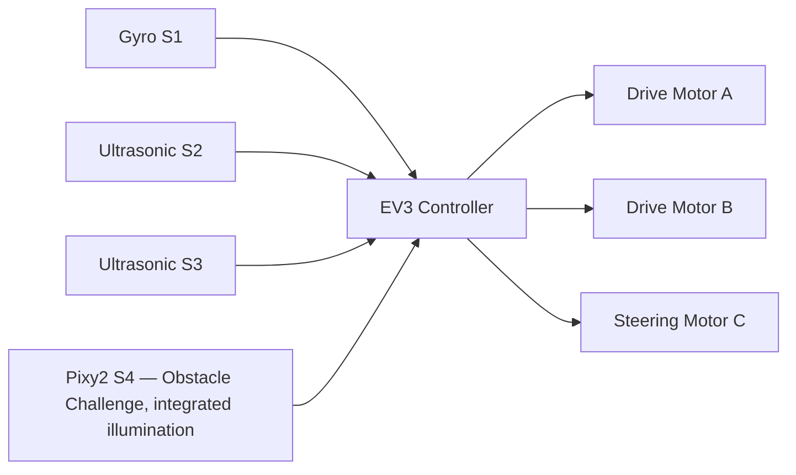

# Hardware Architecture

## Our EV3 setup

Our robot uses a LEGO EV3 controller. This page lists the motors and sensors used by the two challenge programs so the port map can be checked against the wiring and source code.

## Port allocation

| EV3 port | Device | What it does |
|---|---|---|
| A | Medium motor | Drives the vehicle |
| B | Medium motor | Drives the vehicle |
| C | Medium motor | Steers the vehicle |
| D | No device assigned | Not used by either challenge program |
| S1 | Gyro sensor | Gives heading feedback |
| S2 | Ultrasonic sensor | Measures the left-side distance |
| S3 | Ultrasonic sensor | Measures the right-side distance |
| S4 | Pixy2 camera with integrated illumination | Camera and illumination over I²C in the Obstacle Challenge |

**Camera illumination:** The light is part of the Pixy2 assembly connected to S4. It is not a separate device on an EV3 motor port. Port D is unused by both challenge programs.

## How the parts work together

## Motors

- Motors A and B move the robot. The programs use encoder-controlled movement.
- Motor C moves the steering mechanism using target-angle commands.
- The software limits the drive and steering commands and uses encoder feedback to estimate distance.

## Sensors

### Gyro
The gyro gives us heading information. Both programs check drift and calibrate the sensor while the robot is stationary before autonomous movement.

### Ultrasonic sensors
The left and right ultrasonic sensors measure the corridor walls. The programs use these readings for centering, detecting wall openings, and positioning during obstacle manoeuvres.

### Pixy2
The Obstacle Challenge program uses the Pixy2 over I²C at address 0x54. In our documented setup, signature 1 is red and signature 2 is green.

## Wiring points

We should keep connectors secure, add strain relief, and route cables away from the steering parts. Battery, motor, and other electrical ratings must be checked against the component specifications and EV3 operating limits.

## Before running

Our port map assigns drive to A and B, steering to C, no device to D, the gyro to S1, the two ultrasonic sensors to S2 and S3, and the Pixy2 camera with its integrated illumination to S4.