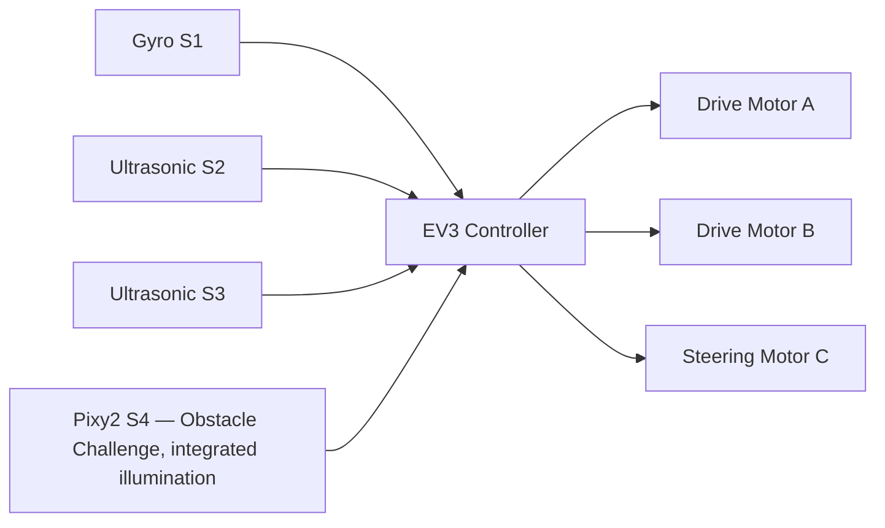

# Hardware Architecture

## System overview

The vehicle control platform is based on LEGO EV3 and the device interfaces declared by the two challenge programs.

## Port allocation

| EV3 port | Device | Function |
|---|---|---|
| A | Medium motor | Propulsion |
| B | Medium motor | Propulsion |
| C | Medium motor | Steering |
| D | No device assigned | Unused by both challenge programs |
| S1 | Gyro sensor | Heading feedback |
| S2 | Ultrasonic sensor | Left-side distance |
| S3 | Ultrasonic sensor | Right-side distance |
| S4 | Pixy2 camera with integrated illumination | I²C vision and camera illumination in Obstacle Challenge |

**Camera illumination:** the illumination belongs to the Pixy2 camera assembly connected to S4. It is not a separate EV3 motor-port device. Port D is unused by both challenge programs.

## Functional architecture

## Actuation

- Drive motors A and B provide propulsion through encoder-controlled movement.
- Steering motor C positions the steering mechanism using target-angle commands.
- The software applies bounded drive and steering commands and uses encoder feedback for distance estimation.

## Sensor integration

### Gyroscope
The gyro provides heading feedback. Both programs perform a stationary drift check and calibration before autonomous movement.

### Ultrasonic sensors
The left and right ultrasonic sensors provide wall-distance observations used for corridor centering, wall-opening detection, and obstacle manoeuvre positioning.

### Pixy2 camera
The Obstacle Challenge program uses Pixy2 over I²C at configured address 0x54. Signature 1 is assigned to red and signature 2 to green.

## Electrical integration principles

Maintain secure connectors, strain relief, and separation between wiring and moving steering components. Battery, motor, and auxiliary-load ratings are governed by the relevant component specifications and the EV3 operating limits.

## Commissioning

The documented interface map assigns propulsion to A/B, steering to C, no device to D, gyro feedback to S1, ultrasonic ranging to S2/S3, and the Pixy2 camera with integrated illumination to S4.
