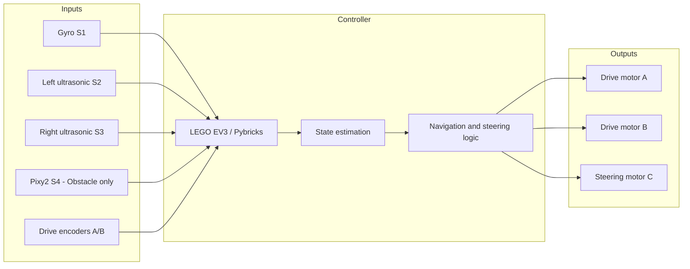

# Hardware Architecture

## Document scope

This page describes the hardware interfaces explicitly declared by the supplied Open Challenge and Obstacle Challenge programs. It does not claim that unlisted components are installed or connected.

## Shared EV3 platform

| Port | Device | Open Challenge use | Obstacle Challenge use |
|---|---|---|---|
| A | Medium motor | Drive | Drive |
| B | Medium motor | Drive | Drive |
| C | Medium motor | Steering | Steering |
| S1 | Gyro sensor | Heading feedback | Heading feedback |
| S2 | Ultrasonic sensor | Left wall range | Left wall range |
| S3 | Ultrasonic sensor | Right wall range | Right wall range |
| S4 | Pixy2 | Not used | Pillar vision |

## Functional architecture

## Interfaces and responsibilities

- **Drive motors A and B:** commanded together by the supplied programs. Encoder angles contribute to distance estimation.
- **Steering motor C:** position-controlled using non-blocking target commands in the main steering routines.
- **Gyro S1:** supplies heading. Both programs measure drift at startup and compensate for the measured rate.
- **Ultrasonic S2 and S3:** provide left and right wall ranges. Their readings support corridor centering and opening detection.
- **Pixy2 S4:** used only by the supplied Obstacle Challenge source to identify red and green signatures.

## Electrical and integration documentation still required

The source files do not specify motor current, supply voltage under load, wiring diagrams, connector pinouts, battery chemistry, fuse ratings, or the electrical specifications of the front lamp or other optional hardware. These details must be added from the actual component datasheets and the team's wiring inspection.

## Commissioning checklist

- [ ] Confirm each port against the program's device map.
- [ ] Confirm drive motor polarity and equal forward response.
- [ ] Confirm steering zero with wheels physically straight.
- [ ] Confirm gyro sign convention by rotating the vehicle by hand.
- [ ] Confirm ultrasonic left/right orientation.
- [ ] For Obstacle Challenge, confirm Pixy2 address, firmware, I²C output mode, and signature IDs.
- [ ] Record battery and cable routing photographs.
- [ ] Record component model numbers and datasheet links.
