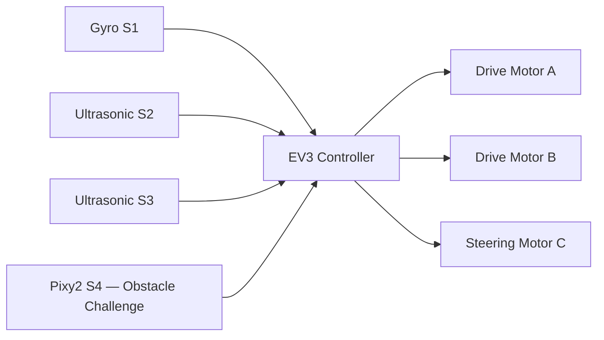

# Hardware Architecture

## System overview

The vehicle control platform is based on LEGO EV3 and the device interfaces declared by the two challenge programs.

## Port allocation

| EV3 port | Device | Function |
|---|---|---|
| A | Medium motor | Propulsion |
| B | Medium motor | Propulsion |
| C | Medium motor | Steering |
| S1 | Gyro sensor | Heading feedback |
| S2 | Ultrasonic sensor | Left-side distance |
| S3 | Ultrasonic sensor | Right-side distance |
| S4 | Pixy2 camera | I²C vision interface in Obstacle Challenge |

**Port D status:** the drawing register identifies a front LED lamp on port D, but neither current challenge source program instantiates or controls a device on that port. Treat the lamp and its wiring as unverified until checked on the assembled vehicle.

## Functional architecture

## Actuation

- Drive motors A and B provide propulsion through encoder-controlled movement.
- Steering motor C positions the steering mechanism using target-angle commands.
- The software applies bounded drive and steering commands and uses encoder feedback for distance estimation.

## Sensor integration

### Gyroscope
The gyro provides heading feedback. Both programs perform a stationary drift check and calibration before autonomous movement.

### Ultrasonic sensors
The left and right ultrasonic sensors provide wall-distance observations used for corridor centering, wall-opening detection, and obstacle manoeuvre positioning.

### Pixy2 camera
The Obstacle Challenge program uses Pixy2 over I²C at configured address 0x54. Signature 1 is assigned to red and signature 2 to green.

## Electrical integration principles

Maintain secure connectors, strain relief, and separation between wiring and moving steering components. Battery, motor, and auxiliary-load ratings are governed by the relevant component specifications and the EV3 operating limits.

## Commissioning

1. Confirm the port allocation.
2. Verify drive motor direction with the vehicle safely supported.
3. Verify steering zero and travel.
4. Calibrate the gyro while stationary.
5. Compare ultrasonic readings with known distances.
6. Confirm Pixy2 communication and signature mapping.
7. Run low-speed functional checks before autonomous operation.
