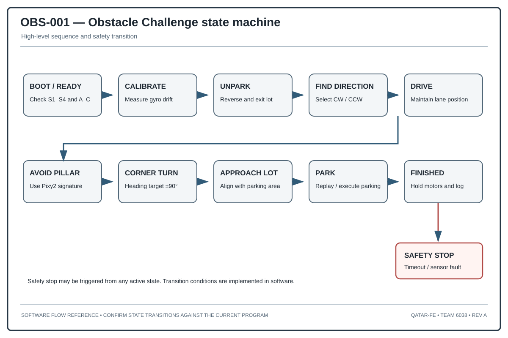
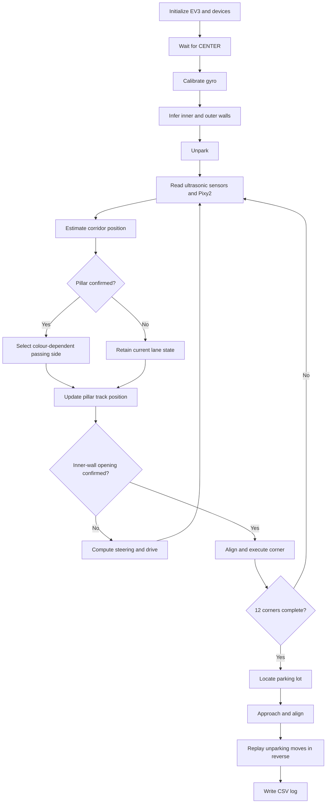

# Obstacle Challenge — Visual Perception and Autonomous Navigation

## Engineering drawings

Camera geometry and the electrical interface are documented in [CAM-001](../../docs/drawings/CAM-001_pixy2_camera_geometry.svg) and [ELE-001](../../docs/drawings/ELE-001_ev3_wiring.svg).

## Program identity

| Field | Source value |
|---|---|
| Program file | `obstacle_challenge.py` |
| Version constant | `OBST-1` |
| Runtime target | Pybricks MicroPython |
| Controller | LEGO EV3 |
| Vision sensor | Pixy2 camera |
| Camera library | `pixycamev3` |
| Camera interface | I²C, address `0x54` |
| Route target | 3 laps / 12 corners |
| Main log | `log_obstacle.csv` |
| Nominal loop period | 20 ms; 10 ms during maneuvers |

This is a source-level description of the supplied program. Values are configured software parameters and must not be interpreted as independently measured performance.

## Mission and state sequence

The program performs a multi-stage autonomous mission:

1. Initialize EV3 motors and sensors and establish encoder zero references.
2. Display READY and wait for the CENTER button.
3. Calibrate gyro drift while stationary.
4. Determine the inner and outer wall from the parking position.
5. Execute a multi-step unparking manoeuvre.
6. Follow the corridor while estimating lateral position and heading.
7. Detect, classify, track, and pass pillars.
8. Detect corridor openings and execute twelve gyro-controlled corners.
9. Estimate the parking-lot location from track position and boundary-wall observations.
10. Approach the lot, align, replay the recorded unparking manoeuvre in reverse, and finish parallel inside the lot.
11. Write the measurement and event log.

## Hardware interface

| Port | Device | Role |
|---|---|---|
| A | Medium motor | Drive motor A |
| B | Medium motor | Drive motor B |
| C | Medium motor | Steering actuator |
| S1 | Gyro sensor | Heading and drift compensation |
| S2 | Ultrasonic sensor | Left wall distance |
| S3 | Ultrasonic sensor | Right wall distance |
| S4 | Pixy2 camera with integrated illumination | I²C red/green pillar detection and camera illumination |

The Pixy2 camera, including its integrated illumination, is connected through sensor port S4 using I²C address `0x54`. The illumination is part of the camera assembly and is not a separate device on EV3 motor port D. The program maps Pixy2 signature 1 to red and signature 2 to green.

## Perception pipeline

### Block acquisition

The program requests blocks matching the red and green signatures. Consecutive I²C errors are counted. Isolated read errors are treated as a missing frame; after `PIXY_MAX_ERRORS` consecutive errors, the exception is allowed to terminate the normal run path.

### Pillar filtering

A candidate block is retained only when:
- its signature is one of the configured pillar signatures;
- its height is at least `MIN_HEIGHT`;
- its height-to-width ratio is at least `MIN_RATIO`.

The nearest candidate is selected by its vertical image position. The candidate must be confirmed over `CONFIRM_FRAMES` observations before it can trigger avoidance.

### Image-to-ground geometry

The source estimates camera-to-pillar distance using the configured model:

`distance_mm = Y_K / (Y - Y_0)`

The horizontal image coordinate is converted to a bearing using the configured horizontal field of view. The calculation also accounts for the camera's forward offset and the vehicle's heading relative to the corridor.

These equations are configured estimation models encoded in the program. Their accuracy depends on camera mounting, image geometry, field-of-view calibration, and the empirical constants `Y_0` and `Y_K`; the repository does not contain a physical calibration dataset.

## Colour-dependent passing policy

| Detected signature | Configured meaning | Passing side |
|---|---|---|
| 1 | Red | Right |
| 2 | Green | Left |

The lane target is calculated to maintain `PILLAR_CLEARANCE` while respecting `WALL_MIN`. The target is not simply a fixed left or right lane: it is calculated from the estimated pillar lateral position and clamped to the available corridor space.

The program retains the pillar's estimated track position while it leaves the camera view. It returns to the center state only after the vehicle has travelled beyond the stored pillar position by `PASS_MARGIN`.

## Lateral localization and wall handling

The left and right ultrasonic readings are projected perpendicular to the corridor using the relative heading. The expected sum of the readings is based on the configured corridor width and sensor span.

When both readings are plausible, the program estimates lateral position from both walls. When the sum is inconsistent, it rejects the likely corrupted side and uses the other wall. If the vehicle heading is outside `WALL_ANGLE_MAX`, or the inferred position is outside the corridor, the lateral estimate is discarded.

This rejection logic is important near wall ends, pillars, and corners, where a wide ultrasonic beam may return a misleading echo.

## Control architecture

The lateral target is selected from three operating states:

- **CENTER** — target the corridor center.
- **AVOID** — shift laterally to pass the currently tracked pillar.
- **PASS** — the pillar is temporarily out of view; retain the last estimated position until the rear-clearance condition is met.

The position error is converted into a desired heading:

`head_goal = clamp(K_LANE × position_error, ±LANE_ANGLE_MAX)`

The steering command then corrects the difference between measured heading and desired heading:

`steer = clamp(KG × (heading - head_goal), ±MAX_STEERING)`

A close-wall override takes priority over the normal command.

## Corner detection and corner execution

The program requires the inner wall to have been seen repeatedly while the vehicle is approximately aligned with the corridor. It then detects a sustained opening after a lockout distance. This reduces false corner detections caused by looking diagonally into the previous corridor immediately after a turn.

If an opening is confirmed while the vehicle is still angled, the program first straightens the vehicle, subject to the configured alignment distance. It then updates the absolute heading target and executes the corner.

During the final part of a turn, the camera may see the first pillar in the next corridor. The program adjusts the steering command according to whether the next pillar should be passed on the inner or outer side.

## Unparking and parking

The unparking manoeuvre is a sequence of recorded distance moves and gyro-referenced turns. The parking routine replays those moves in reverse order and opposite travel direction. The final parking approach uses the outer-wall distance and detects boundary-wall transitions to refine the estimated lot position.

This is a trajectory-reversal strategy. Its repeatability depends on steering response, wheel traction, encoder distance, and gyro heading. No repeated physical parking-trial dataset is included in this repository.

## Key configured parameters

| Parameter | Value | Unit | Purpose |
|---|---:|---|---|
| `DRIVE_SPEED` | 250 | deg/s | Nominal drive speed |
| `WHEEL_DIAMETER` | 56 | mm | Encoder distance conversion |
| `DIST_SCALE` | 1.0 | ratio | Distance correction factor |
| `MAX_STEERING` | 30 | deg | Driving steering limit |
| `K_LANE` | 0.30 | deg/mm | Lateral-to-heading gain |
| `LANE_ANGLE_MAX` | 45 | deg | Desired heading limit |
| `KG` | 0.8 | deg/deg | Heading correction gain |
| `CORRIDOR_WIDTH` | 1000 | mm | Configured corridor width |
| `SENSOR_SPAN` | 160 | mm | Separation of sonar faces |
| `OPEN_DISTANCE` | 1200 | mm | Inner-wall opening threshold |
| `TOTAL_CORNERS` | 12 | corners | Three-lap route count |
| `SIG_RED` / `SIG_GREEN` | 1 / 2 | signature | Pixy2 colour mapping |
| `CONFIRM_FRAMES` | 3 | frames | Pillar confirmation |
| `Y_0` | 63 | px | Image-distance model offset |
| `Y_K` | 20100 | px·mm | Image-distance model scale |
| `CAM_FOV` | 60 | deg | Horizontal camera field of view |
| `CAM_OFFSET` | 100 | mm | Camera forward offset |
| `PILLAR_CLEARANCE` | 150 | mm | Minimum centre-to-pillar target |
| `PASS_MARGIN` | 200 | mm | Rear-clearance travel margin |
| `MAX_RUN_TIME` | 180000 | ms | Global time limit |

## Software flow

## Logging and diagnostics

The log header includes time, phase, corner count, track position, raw and perpendicular wall readings, estimated vehicle lateral position, target position, pillar position, position error, relative heading, heading goal, steering command, actual steering angle, Pixy2 signature and image coordinates, and pillar state. Event records describe camera errors, pillar acquisition and passing, openings, corners, parking-wall detection, parking, and failures.

## Calibration and physical-evidence status

The source configuration records the Pixy2 I²C address, signature mapping, image-distance constants, camera field of view, and camera offset. The repository also records the ultrasonic geometry and encoder scale parameters. No physical calibration dataset or completed EV3 mission-test logs are stored in this repository snapshot.

## Review points

- Camera range is inferred from image position using the configured empirical model. It is not a direct range measurement, and no physical calibration dataset is included in this repository.
- A missed or misclassified frame can delay obstacle tracking. Confirmation thresholds reduce, but do not eliminate, this risk.
- Ultrasonic readings can be distorted by wall ends, oblique incidence, pillars, and nearby boundary structures.
- Reverse replay assumes that the physical trajectory is sufficiently repeatable in both directions.
- A timeout or fallback estimate protects program flow but does not prove successful navigation or parking.

## Source integrity

The supplied source is preserved as `obstacle_challenge.py`. SHA-256:

`8e95b338db948a291cea3b166b8def8d28525c5e5ada0540324d954e4f12e952`

Static Python parsing completed successfully before repository upload. This is not a Pybricks hardware execution test.
