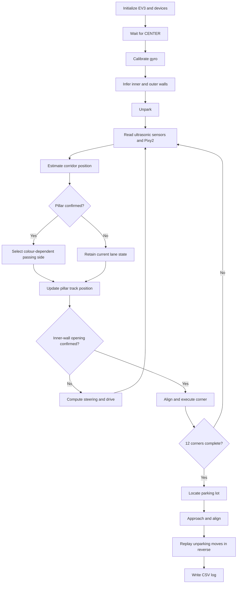

# Obstacle Challenge — Camera Detection and Autonomous Navigation

## Drawings

The camera view and electrical connection are also shown in [CAM-001](../../docs/drawings/CAM-001_pixy2_camera_geometry.svg) and [ELE-001](../../docs/drawings/ELE-001_ev3_wiring.svg).

## Program information

| Item | Value in the source |
|---|---|
| Program file | `obstacle_challenge.py` |
| Version constant | `OBST-1` |
| Runtime | Pybricks MicroPython |
| Controller | LEGO EV3 |
| Camera | Pixy2 |
| Camera library | `pixycamev3` |
| Camera connection | I²C, address `0x54` |
| Route target | 3 laps / 12 corners |
| Main log | `log_obstacle.csv` |
| Configured loop period | 20 ms; 10 ms during manoeuvres |

This page explains the settings and logic in the current source file. The values are program settings, not measurements of the robot's performance.

## How the mission is organized

The program is arranged into these stages:

1. Start the EV3 motors and sensors and set the encoder reference positions.
2. Show READY and wait for the CENTER button.
3. Calibrate gyro drift while the robot is still.
4. Work out which wall is on the inside and which is on the outside from the parking position.
5. Move out of the parking area using a sequence of manoeuvres.
6. Follow the corridor and estimate the robot's sideways position and heading.
7. Detect the pillars, identify their colours, track them, and pass on the required side.
8. Detect corridor openings and carry out twelve gyro-controlled corners.
9. Estimate the parking area using track position and wall readings.
10. Approach and align with the parking area, reverse the recorded unparking sequence, and finish parallel inside the area.
11. Save the measurement and event log.

## Hardware connections

| Port | Device | Use |
|---|---|---|
| A | Medium motor | Drive motor A |
| B | Medium motor | Drive motor B |
| C | Medium motor | Steering |
| S1 | Gyro sensor | Heading and drift correction |
| S2 | Ultrasonic sensor | Left wall distance |
| S3 | Ultrasonic sensor | Right wall distance |
| S4 | Pixy2 camera with integrated illumination | Red and green pillar detection over I²C |

The Pixy2 and its illumination are one assembly on sensor port S4, using I²C address `0x54`. The illumination is not a separate device on motor port D. The program uses signature 1 for red and signature 2 for green.

## How we detect a pillar

### Reading camera blocks

The program asks the Pixy2 for blocks matching the red and green signatures. It counts consecutive I²C errors. A single read error is treated as a missing frame. If the number of consecutive errors reaches `PIXY_MAX_ERRORS`, the normal run path is interrupted by the exception.

### Filtering possible pillars

A block is kept as a candidate only if:
- Its signature is one of the configured pillar signatures.
- Its height is at least `MIN_HEIGHT`.
- Its height-to-width ratio is at least `MIN_RATIO`.

The program chooses the nearest candidate using its vertical image position. The candidate must remain detected for `CONFIRM_FRAMES` observations before it can start an avoidance action.

### Estimating position from the image

The program estimates camera-to-pillar distance using:

`distance_mm = Y_K / (Y - Y_0)`

It also uses the horizontal image coordinate and configured horizontal field of view to estimate the bearing. The calculation accounts for the camera's forward offset and the robot's heading relative to the corridor.

These are estimation equations. Their accuracy depends on camera mounting, image geometry, field-of-view calibration, and the values of `Y_0` and `Y_K`. This repository does not contain physical camera-calibration measurements.

## Passing the pillars

| Camera signature | Colour in our setup | Side to pass |
|---|---|---|
| 1 | Red | Right |
| 2 | Green | Left |

The program calculates a lane target that should keep the configured `PILLAR_CLEARANCE` while respecting `WALL_MIN`. It uses the estimated pillar position and available corridor space rather than always choosing one fixed lane position.

If the pillar disappears from the camera view, the program keeps its last estimated position. It returns to the centre state only after the robot has travelled beyond that position by the configured `PASS_MARGIN`.

## Estimating position between the walls

The program uses the two ultrasonic readings and the robot's heading to estimate the distances perpendicular to the corridor. It checks whether their sum is close to the configured corridor width and sensor spacing.

If both readings look reasonable, the program uses both to estimate the robot's lateral position. If the sum does not make sense, it rejects the reading that is more likely to be wrong and uses the other wall. If the heading is outside `WALL_ANGLE_MAX`, or the estimated position is outside the corridor, it discards the lateral estimate.

This matters near wall ends, pillars, and corners because the wide ultrasonic beam can return an echo from an unexpected surface.

## Steering states

The lane target is selected from three states:

- **CENTER** — aim for the middle of the corridor.
- **AVOID** — move sideways to pass the pillar being tracked.
- **PASS** — the pillar is temporarily out of view, so keep its last estimated position until the rear-clearance condition is reached.

The position error is converted into a heading target:

`head_goal = clamp(K_LANE × position_error, ±LANE_ANGLE_MAX)`

The steering command then corrects the difference between the measured heading and the target:

`steer = clamp(KG × (heading - head_goal), ±MAX_STEERING)`

A close-wall override has priority over the normal steering command.

## Finding and turning at corners

The program first needs to see the inner wall repeatedly while the robot is approximately aligned with the corridor. It then looks for a sustained opening after a lockout distance. This helps prevent the previous corridor opening from being detected again just after a turn.

If the opening is confirmed while the robot is still angled, the program first tries to straighten it, within the configured alignment distance. It then updates the absolute heading target and carries out the corner.

Near the end of a turn, the camera may already see the first pillar in the next corridor. The program adjusts the steering command depending on whether that pillar should be passed on the inside or outside.

## Leaving and returning to the parking area

The unparking manoeuvre is made from recorded distance moves and gyro-referenced turns. For parking, the program replays these moves in reverse order and in the opposite travel direction. It also uses the outer-wall distance and changes in the boundary-wall readings to improve its estimate of the parking position.

This method depends on the robot following a similar path in both directions. Steering, wheel grip, encoder distance, and gyro heading can all affect the result. This repository does not include repeated physical parking-test logs.

## Main configured values

| Parameter | Value | Unit | Purpose |
|---|---:|---|---|
| `DRIVE_SPEED` | 250 | deg/s | Normal drive speed |
| `WHEEL_DIAMETER` | 56 | mm | Encoder distance calculation |
| `DIST_SCALE` | 1.0 | ratio | Distance correction |
| `MAX_STEERING` | 30 | deg | Driving steering limit |
| `K_LANE` | 0.30 | deg/mm | Lateral-to-heading gain |
| `LANE_ANGLE_MAX` | 45 | deg | Heading target limit |
| `KG` | 0.8 | deg/deg | Heading correction gain |
| `CORRIDOR_WIDTH` | 1000 | mm | Configured corridor width |
| `SENSOR_SPAN` | 160 | mm | Distance between sonar faces |
| `OPEN_DISTANCE` | 1200 | mm | Inner-wall opening threshold |
| `TOTAL_CORNERS` | 12 | corners | Three-lap route |
| `SIG_RED` / `SIG_GREEN` | 1 / 2 | signature | Pixy2 colour mapping |
| `CONFIRM_FRAMES` | 3 | frames | Pillar confirmation |
| `Y_0` | 63 | px | Image-distance offset |
| `Y_K` | 20100 | px·mm | Image-distance scale |
| `CAM_FOV` | 60 | deg | Horizontal camera field of view |
| `CAM_OFFSET` | 100 | mm | Camera forward offset |
| `PILLAR_CLEARANCE` | 150 | mm | Minimum centre-to-pillar target |
| `PASS_MARGIN` | 200 | mm | Travel after estimated pillar position |
| `MAX_RUN_TIME` | 180000 | ms | Overall time limit |

## Program flow

## What the program records

The CSV log includes time, phase, corner count, track position, raw and perpendicular wall readings, estimated lateral position, target position, pillar position, position error, relative heading, heading target, steering command, actual steering angle, Pixy2 signature and image coordinates, and pillar state.

Event records can describe camera errors, pillar detection and passing, corridor openings, corners, parking-wall detection, parking, and failures.

## Calibration and physical evidence

The source file contains the Pixy2 I²C address, signature mapping, image-distance constants, camera field of view, and camera offset. It also contains ultrasonic geometry and encoder scale settings. We have not added a physical calibration dataset or completed EV3 mission logs to this repository.

## Points we still need to check

- The camera range is estimated from image position. It is not a direct distance reading, and the repository does not include a physical calibration dataset.
- A missed or incorrectly classified frame can delay obstacle tracking. Confirmation frames help, but cannot remove this risk.
- Ultrasonic readings can be affected by wall ends, angled surfaces, pillars, and nearby structures.
- Reversing the unparking sequence assumes the robot can repeat the same path in the opposite direction.
- A timeout or fallback estimate helps control the program, but does not prove that navigation or parking succeeded.

## Source file

The supplied program is kept as `obstacle_challenge.py`.

SHA-256: `8e95b338db948a291cea3b166b8def8d28525c5e5ada0540324d954e4f12e952`

We checked that the Python file parses before uploading it. This syntax check does not confirm that the program runs correctly on the EV3 robot.