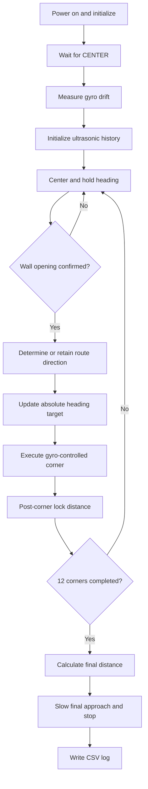

# Open Challenge — Autonomous Navigation

## Program identity

| Field | Source value |
|---|---|
| Program file | `open_challenge.py` |
| Version constant | `OPEN-COMP-2` |
| Runtime target | Pybricks MicroPython |
| Controller | LEGO EV3 |
| Route target | 3 laps / 12 corners |
| Main log | `log_open.csv` |
| Nominal loop period | 20 ms on straights; 10 ms during turns |

This document describes the supplied source program. Parameter values below are software configuration values, not independent measurements of vehicle performance.

## Mission sequence

1. Initialize steering and drive-motor encoder references.
2. Display the ready state and wait for the CENTER button.
3. Calibrate gyro drift while the vehicle is stationary.
4. Initialize the ultrasonic filters.
5. Drive the corridor while centering and holding the target heading.
6. Detect the first wall opening to infer the randomly assigned route direction.
7. Confirm each opening, execute a 90-degree corner, and lock out immediate re-detection.
8. Record the first opening distance and the corresponding start-side segment lengths.
9. After the twelfth corner, calculate the remaining distance to the start section.
10. Reduce speed during the final approach, stop, and write the run log.

## Hardware interface

| Port | Device | Software role |
|---|---|---|
| A | Medium motor | Drive motor A |
| B | Medium motor | Drive motor B |
| C | Medium motor | Steering actuator |
| S1 | Gyro sensor | Heading and drift compensation |
| S2 | Ultrasonic sensor | Left wall range |
| S3 | Ultrasonic sensor | Right wall range |

The source configures the gyro with `Direction.CLOCKWISE`. Its comments specify that a left turn produces a negative gyro angle. Steering command sign is separately defined: positive steering means wheels turned left.

## Control architecture

### Corridor centering

The program reads both ultrasonic sensors and uses a median of the latest three samples for each side. When both walls are visible and the heading is within `WALL_HEADING_MAX`, it calculates the left/right range difference:

`diff = left - right`

A deadband of `CENTER_TOLERANCE` removes small errors. The steering command combines lateral correction and heading correction:

`cmd = KP × diff + KG × heading_error`

The result is clamped to `±MAX_STEERING`. A close-wall safety override has priority over the normal controller.

### Corner detection

The program detects a wall opening using raw ultrasonic values. Before the route direction is known, the first side to open determines the direction. Thereafter, only the inner wall is monitored. The opening must persist for `OPEN_CONFIRM` consecutive readings.

The corner target is updated by an absolute 90-degree increment. The gyro is therefore used against an absolute heading target rather than integrating a fixed turn duration. A timeout and wrong-way gyro check provide protective exits.

### Start-position return

The program stores:
- `d0`: distance from the start to the first opening;
- two measurements of the start-side segment from later laps;
- the mean segment length `L`.

The final travel distance is calculated as `L - d0 + FINAL_OFFSET`. If the measurements are unavailable, `FINAL_DISTANCE` is used as a fallback. The final `FINAL_SLOW_DIST` is driven at `FINAL_SLOW_SPEED`.

## Key configured parameters

| Parameter | Value | Unit | Purpose |
|---|---:|---|---|
| `DRIVE_SPEED` | 300 | deg/s | Nominal drive motor speed |
| `WHEEL_DIAMETER` | 56 | mm | Encoder distance conversion |
| `MAX_STEERING` | 10 | deg | Straight-line steering limit |
| `STEERING_TURN` | 20 | deg | Corner steering command |
| `KP` | 0.09 | deg/mm | Lateral centering gain |
| `KG` | 0.6 | deg/deg | Heading correction gain |
| `CENTER_TOLERANCE` | 10 | mm | Lateral deadband |
| `WALL_MAX` | 950 | mm | Wall visibility threshold |
| `WALL_DANGER` | 150 | mm | Emergency wall proximity threshold |
| `OPEN_DISTANCE` | 1000 | mm | Opening detection threshold |
| `OPEN_CONFIRM` | 2 | samples | Opening confirmation |
| `TURN_ANGLE` | 90 | deg | Corner heading increment |
| `TURN_TIMEOUT` | 4000 | ms | Corner timeout |
| `LOCK_DISTANCE` | 450 | mm | Post-corner detection lockout |
| `TOTAL_CORNERS` | 12 | corners | Three-lap route count |
| `MAX_RUN_TIME` | 180000 | ms | Global time limit |

## Software flow

## Logging and observability

The program records periodic data and event records. The header includes time, phase, corner count, route direction, encoder distance, filtered and raw ultrasonic values, heading, target heading, steering command, actual steering angle, motor speeds, opening side, and opening confirmation count. Event records document state transitions and important events.

The log is intended to support post-run diagnosis. A log file is only created if the program reaches its finalization path and the EV3 filesystem permits the write.

## Calibration and tuning workflow

1. Confirm the wheels are physically straight before startup because the program resets the steering encoder to zero.
2. Measure a known straight-line distance and compare it with encoder-derived distance.
3. Confirm wheel diameter and effective gear ratio.
4. Record gyro drift over the configured stationary interval.
5. Confirm ultrasonic readings against known wall distances and check sensor alignment.
6. Tune `KP` at low speed before increasing speed.
7. Tune `KG` to reduce heading oscillation without masking lateral error.
8. Tune corner steering and early-stop values using repeatable corner tests.
9. Verify the final-stop distance over repeated complete runs.

Change one parameter family at a time and retain the original source as the reference.

## Review points

- The distance estimator assumes the configured wheel diameter and gear ratio are representative of the effective rolling geometry.
- The ultrasonic centering calculation is intentionally disabled when the vehicle heading is too far from the corridor axis.
- The final return estimate depends on the repeatability of the measured start-side segment.
- The software uses motor encoder distance; wheel slip and unequal drive response can create odometry error.
- A timeout is a protective condition, not proof that a corner was completed correctly.

## Source integrity

The supplied source is preserved as `open_challenge.py`. SHA-256:

`98d847d3af9af3f7ec30763fcb2fc559d1024847b13d7bebe3ae92736452d85b`

Static Python parsing completed successfully before repository upload. This is a syntax check only; it is not a Pybricks hardware execution test.
