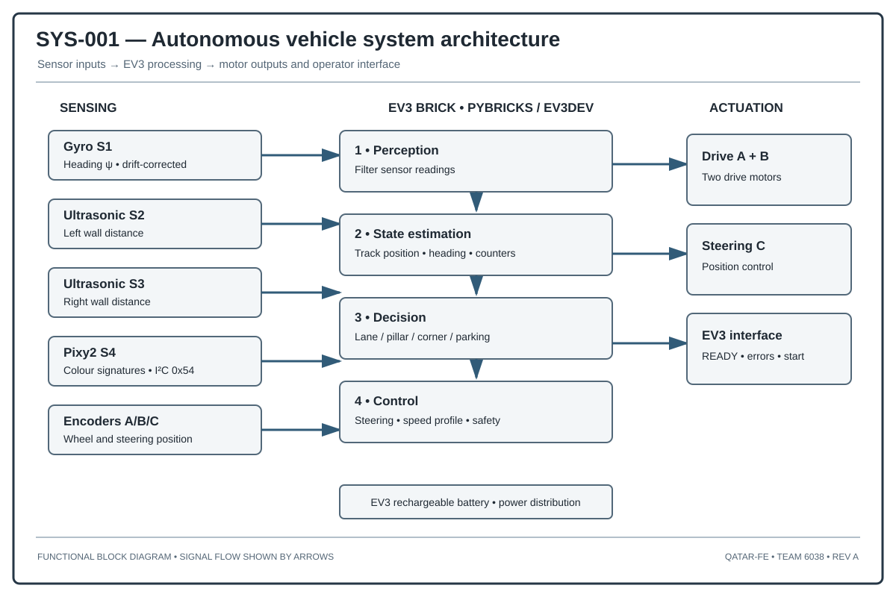

# Open Challenge — Technical Documentation

## Mission

The vehicle dynamics and steering references are available in [DYN-001](../../docs/drawings/DYN-001_vehicle_dynamics.svg) and [STR-001](../../docs/drawings/STR-001_ackermann_steering.svg).

For the Open Challenge, our controller follows a route with twelve corners. It keeps the robot centred in the corridor, corrects its heading, and calculates the final approach back to the starting section.

## Hardware interfaces

| Port | Device | Function |
|---|---|---|
| A | EV3 Medium Motor | Left/right drive channel as configured by the program |
| B | EV3 Medium Motor | Drive channel |
| C | EV3 Medium Motor | Steering |
| S1 | Gyro | Heading measurement |
| S2 | Ultrasonic | Left wall range |
| S3 | Ultrasonic | Right wall range |

## Program configuration

| Parameter | Value |
|---|---:|
| Version | OPEN-COMP-2 |
| Drive speed | 300 deg/s |
| Wheel diameter | 56 mm |
| Gear ratio | 1 |
| Straight steering limit | 10 deg |
| Corner steering command | 20 deg |
| Lateral gain | 0.09 |
| Heading gain | 0.6 |
| Centre tolerance | 10 mm |
| Wall detection limit | 950 mm |
| Wall danger threshold | 150 mm |
| Corner target | 90 deg |
| Route corner count | 12 |

## Mission sequence

1. Initialize motors and sensors.
2. Wait for the operator start command.
3. Calibrate the gyro while stationary.
4. Acquire left and right wall distances.
5. Estimate corridor-centre error.
6. Apply lateral and heading corrections.
7. Confirm a corridor opening over consecutive samples.
8. Determine route direction and execute the corner.
9. Apply post-turn detection lockout.
10. Track the twelve-corner route.
11. Calculate and execute the final approach.
12. Stop and write the run log.

## Corridor-centering control

We use both ultrasonic readings to estimate the robot's lateral position in the corridor. A proportional lateral term is combined with a heading correction term. The resulting steering command is bounded by the configured straight-line steering limit.

## Corner detection and execution

We confirm an opening only after the distance threshold has been exceeded for several consecutive readings. A distance lockout after each turn prevents the previous opening from being detected again. Gyro heading is used to track the turn target, while timeout and wrong-direction checks protect the manoeuvre.

## Return-to-start calculation

The final approach uses the initial opening distance and the measured route segments retained by the program. The final distance command is calculated from these route quantities and the configured offset. The final low-speed segment reduces approach speed near the stopping point.

## Logging

The program writes `log_open.csv`. The log records phase, route progress, sensor observations, heading, steering, and event information for post-run analysis.

## Software evidence scope

Here we describe the program settings and the control logic used in this version. Our automated checks verify Python syntax and documentation consistency. They do not replace a route test with the physical EV3 robot. No completed physical mission log is included in this repository snapshot.
